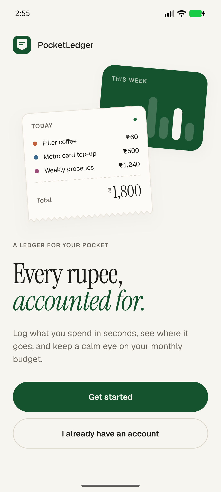
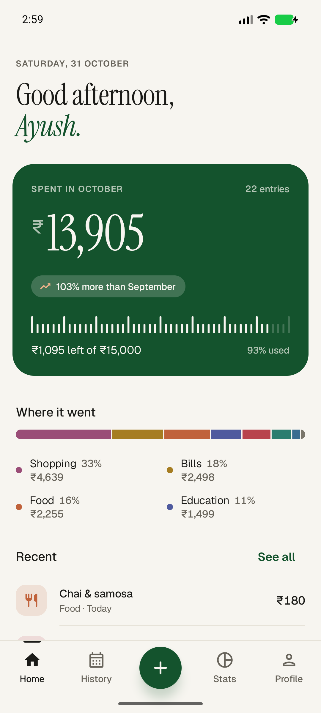
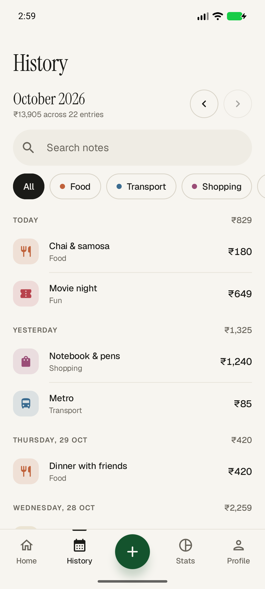
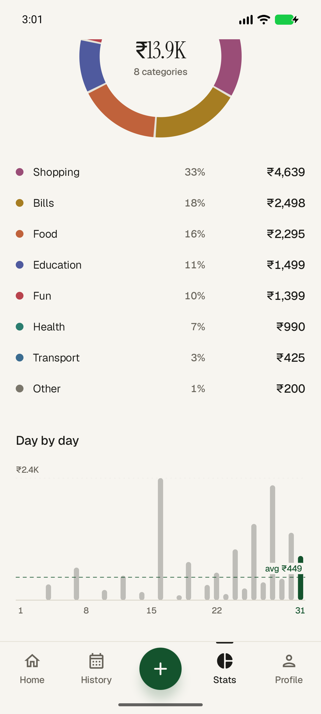
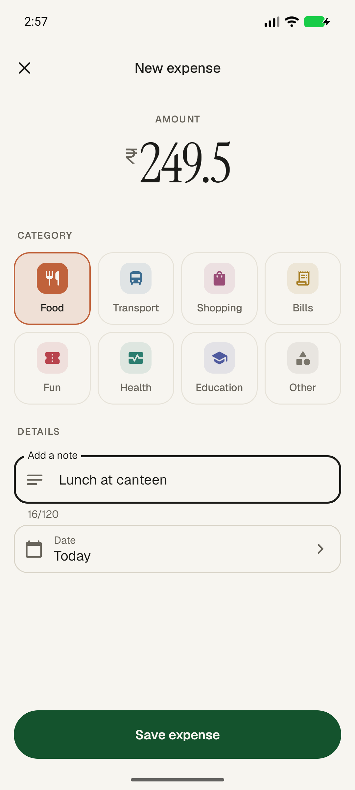
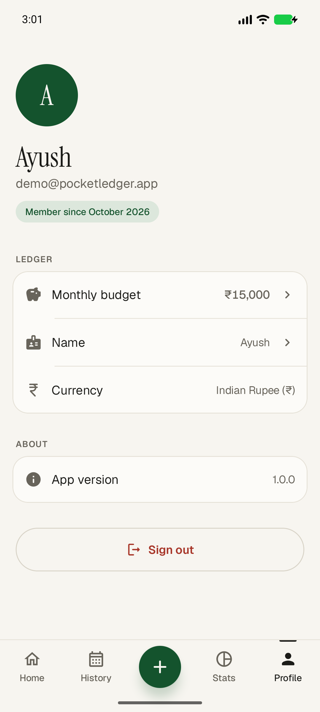
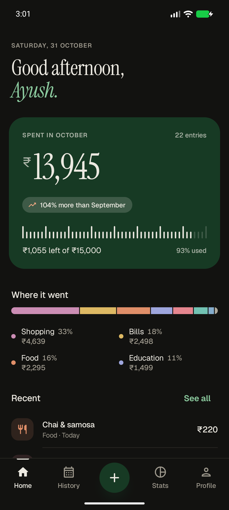
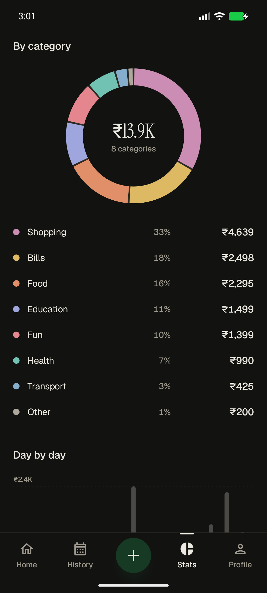

# PocketLedger

A minimal personal expense tracker for Android, built for the Mobile Application Development course. Log what you spend in rupees, see where the money goes, and keep an eye on a monthly budget.

<p>
  
  
  
  
</p>
<p>
  
  
  
  
</p>

**Demo video:** [`artifacts/pocketledger-demo-2x.mp4`](artifacts/pocketledger-demo-2x.mp4) (2× speed, ~3.5 min) · full speed: [`artifacts/pocketledger-demo.mp4`](artifacts/pocketledger-demo.mp4)
**Installable APK:** [`artifacts/PocketLedger.apk`](artifacts/PocketLedger.apk)

## Features

- **Sign up / sign in** with email and password: live validation, password strength meter, clear errors, and the session stays signed in across restarts.
- **Home:** this month's spending, budget progress, comparison with last month, category breakdown and recent expenses. Pull to refresh.
- **Add / edit expense:** large amount input with Indian digit grouping (₹1,25,000), category tiles, note, and a date picker that blocks future dates.
- **History:** browse by month, search notes, filter by category, swipe to delete with Undo, tap to edit.
- **Stats:** custom-drawn donut chart by category, a daily bar chart with the average line, daily average, and change vs last month.
- **Profile:** edit name and monthly budget, sign out.
- Light and dark themes, edge-to-edge layout, predictive back gesture.

## Tech stack

| Part | Technology |
|---|---|
| Android app | Kotlin, Jetpack Compose, Material 3, Navigation 3, ViewModel + StateFlow, Retrofit + kotlinx.serialization, DataStore |
| Session security | Bearer token encrypted with an AES-256-GCM key in the Android Keystore, never backed up |
| API server | Bun, Hono, Better Auth (email/password, signed bearer tokens, rate limiting), Zod validation |
| Database | PostgreSQL 18 (Docker) via Drizzle ORM |

Dependencies are wired by hand in `AppContainer.kt` (no Hilt) to keep the code easy to follow.

```
android/app/src/main/java/me/aysh/pocketledger/
├── data/          models, Retrofit API, repositories, encrypted session store
├── ui/            one package per screen (screen + ViewModel), theme, shared components
│   └── navigation/   Navigation 3 routes and transitions
└── util/          money formatting/parsing, validation, dates
server/src/
├── auth.ts        Better Auth configuration
├── app.ts         Hono app, security headers, error handling
├── routes/        /api/expenses, /api/summary, /api/me
└── db/            Drizzle schema, migrations, demo seed
```

## Running it on a Mac

**You need:** [Android Studio](https://developer.android.com/studio), [Docker Desktop](https://www.docker.com/products/docker-desktop/) and [Bun](https://bun.sh) (`curl -fsSL https://bun.sh/install | bash`).

**1. Start the database and API server**

```bash
docker compose up -d                 # Postgres on localhost:5433
cd server
cp .env.example .env                 # then set BETTER_AUTH_SECRET (see below)
bun install
bun run db:migrate
bun run db:seed                      # optional: demo account with sample data
bun run dev                          # API on http://localhost:8787
```

To generate a secret, run `openssl rand -base64 32` and paste the result into `BETTER_AUTH_SECRET` in `server/.env`.

**2. Run the app**

1. Open the `android/` folder in Android Studio and let Gradle sync.
2. Create an emulator in Device Manager (any recent Pixel image works) and press **Run**.
3. On Android 17 (API 37) and newer, the app asks for permission to reach devices on your local network on first launch. Tap **Allow**: the server runs on your Mac, which the emulator reaches at `10.0.2.2`.

Or install the prebuilt APK on a running emulator: `adb install artifacts/PocketLedger.apk`.

**Demo account** (after `bun run db:seed`): `demo@pocketledger.app` / `demo12345`

## Testing

```bash
cd server && bun test                        # 60 API tests (auth, validation, user isolation, summaries)
cd android && ./gradlew testDebugUnitTest    # 27 unit tests (money, validation, repositories)
python3 scripts/demo.py                      # 24-check end-to-end walkthrough on a running emulator
scripts/record.sh                            # same walkthrough, recorded to artifacts/pocketledger-demo.mp4
```

The server tests use a separate `pocketledger_test` database, which `docker compose` creates automatically.

## Security notes

- Passwords are hashed by Better Auth (scrypt). Sessions are signed tokens; unsigned or tampered tokens are rejected.
- Sign-in and sign-up are rate limited by the real client IP. Forged forwarding headers are ignored.
- Every expense query is scoped to the signed-in user. Inputs are validated with Zod, request bodies are capped at 16 KB, and searches escape SQL wildcards.
- The app only allows plain HTTP to the local development hosts (`10.0.2.2`, `localhost`). Everything else requires HTTPS.
